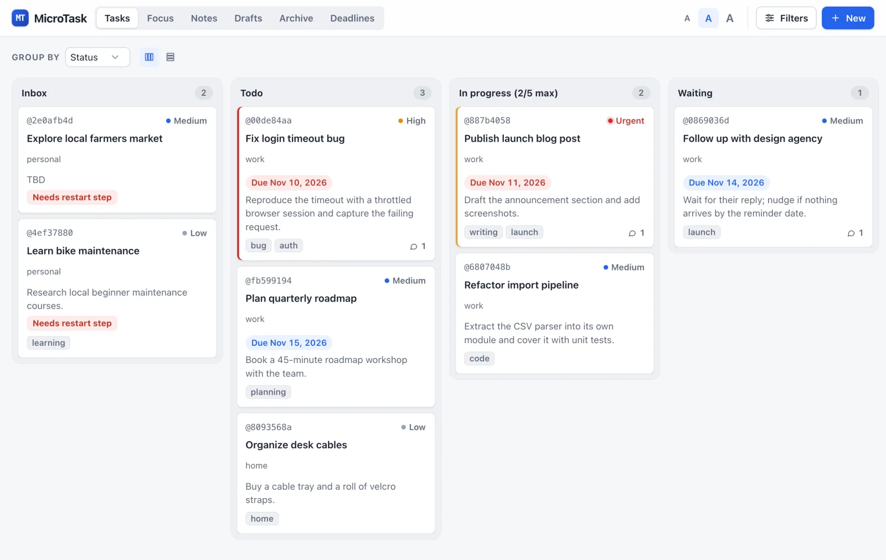

# microtask

**A task and notes manager for you and your AI agents, kept as plain Markdown
files in your own Git repo.**

<p align="center">
  
</p>

Most task apps store your data on their servers in their own format. microtask
keeps each task and note as a Markdown file in a private repository you own, so
you, your editor, and your agents all work on the same files. Everything starts
from the `mt` command, and `mt web` adds a lightweight local dashboard when you
want the overview.

## Why microtask

- **Plain files you own.** One Markdown file per card. Open it in any editor,
  grep it, and read it in ten years without microtask.
- **Nothing to install.** Runs with the Bash and Python 3 already on macOS and
  Linux, and there is no account to create.
- **Terminal first.** Capture in a second with `mt add`, find anything with
  `mt search`, and pipe text in from other tools. The dashboard is optional and
  edits the same files.
- **Ready for your agents.** Any agent that can run shell commands can use it
  without extra setup. The workspace's `AGENTS.md` and microtask skill explain
  the commands, and the CLI rejects edits made from an outdated copy of a card,
  so an agent can work on your list safely.
- **Synced and versioned by Git.** `mt sync` backs up to your private repo and
  keeps your machines in step, with full history of every change.

## Quick start

```sh
curl -fsSL https://raw.githubusercontent.com/pablormier/microtask/main/install.sh | bash
```

Open a new terminal, then:

```sh
mt add "Call the dentist" --status active
mt list
mt move @4e91a7c2 doing      # use the @reference that mt list prints
mt done @4e91a7c2
```

A new workspace starts with example cards so every command has something to
work on. They disappear as soon as you create your first card.

To sync across machines, create an empty private repository (not a fork,
which GitHub keeps public) and pass it when installing
(`… | bash -s -- ~/todo git@github.com:YOU/tasks.git`). On another machine:

```sh
gh repo clone YOU/tasks ~/todo && ~/todo/install.sh
```

## A card is just Markdown

```markdown
---
id: 2026-11-09-140000-fix-login-timeout-bug
title: Fix login timeout bug
kind: task
status: active
priority: high
type: bug
topic: work
due: '2026-11-10'
due_kind: deadline
tags:
- bug
- auth
next_action: Reproduce the timeout with a throttled browser session.
comments:
- at: '2026-11-10T09:10:00'
  text: Suspect the refresh token call is not retried.
---
Users on slow connections get logged out after 30 seconds.

## Plan

- [x] Reproduce with network throttling
- [ ] Start the idle timer on `load` instead of `navigationStart`
```

Properties live in the frontmatter; the body is free-form Markdown with tables,
checklists, code, and math. See [Card files](docs/cards.md).

## Dashboard

When you want to see everything at once, `mt web` opens a board in your
browser. It is served by `mt` itself from your machine, needs nothing extra
installed, and stops when you press Ctrl+C.



## Working with AI agents

Open your workspace in an agent such as Claude Code or Codex and ask in plain
language:

- *"Add a task to renew my passport before March, high priority."*
- *"Go through my inbox and suggest a status and topic for each card."*
- *"What should I work on next? Start it and keep notes in the card."*

The agent follows [AGENTS.md](AGENTS.md) and the
[microtask skill](.agents/skills/microtask/SKILL.md). Codex and Cursor read
`AGENTS.md` on their own, and the workspace's `CLAUDE.md` and `GEMINI.md`
point Claude Code and Gemini CLI to it. For other agents, ask them to read
`AGENTS.md` first. The agent proposes new cards for your review before
creating them, claims a task before working on it, and does not complete or
delete anything without your OK.

With Git (the installer's default), `git diff` shows exactly what an agent
changed in your workspace, and you can undo any of it.

## Learn more

- [Guide](docs/guide.md): statuses, capture, search, topics, the dashboard,
  drafts, and workspaces
- [Card files](docs/cards.md): the file format and safe scripted edits
- [Install, sync, and updates](docs/sync-and-updates.md): remotes, new
  machines, and keeping the app up to date
- `mt help` and `mt COMMAND --help`: every command and option

Contributing: read [CONTRIBUTING.md](CONTRIBUTING.md) and the [test guide](tests/README.md).

## License

microtask is released under the [MIT License](LICENSE). It bundles PyYAML under
its own MIT license ([scripts/vendor/PyYAML-LICENSE](scripts/vendor/PyYAML-LICENSE)).
