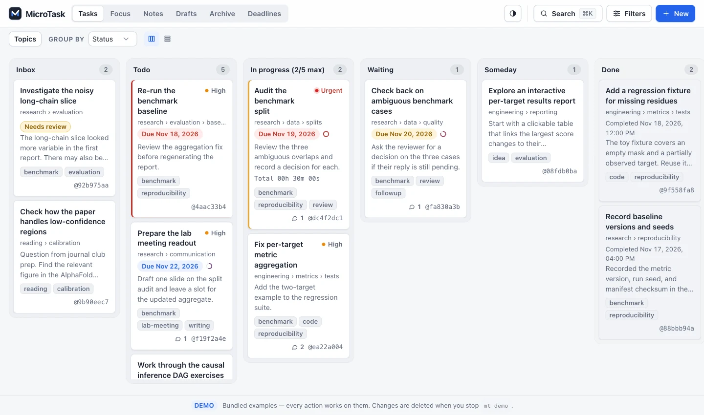
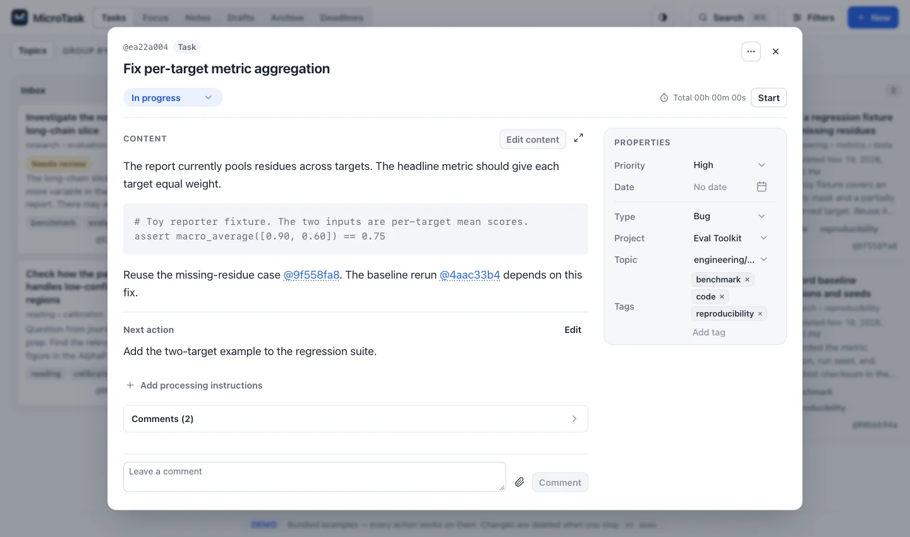

<p align="center">
  
</p>

<h1 align="center">MicroTask</h1>

<p align="center">
  <strong>A task and notes manager for you and your AI agents.</strong><br>
  Each task and note is a Markdown file in a folder you own, synced through your own private Git repository.
</p>

You work with the `mt` command in a terminal. `mt web` opens a dashboard in
your browser, served from your own machine. Your editor and your agents read
and change the same files.



- Each card is one Markdown file, readable in any editor.
- `mt` needs Bash and Python 3, which macOS and Linux already have. There is no
  account and no server.
- Any agent that can run shell commands can use it. `AGENTS.md` and the
  microtask skill tell it how, and `mt` refuses edits made from an outdated
  copy of a card.
- `mt sync` commits your changes and keeps your machines in step through your
  private repository.

## Install

```bash
curl -fsSL https://raw.githubusercontent.com/pablormier/microtask/main/install.sh | bash
```

The installer downloads the latest release and asks where to put the app and
your cards. Enter accepts each default. It adds `mt` to your shell config.

Or clone the repository and create its workspace:

```bash
git clone https://github.com/pablormier/microtask.git && cd microtask && ./mt init
```

Then, in a new terminal (or with `./mt` in the clone):

```sh
mt add "Call the dentist" --status active
mt list
mt move @4e91a7c2 doing      # use the @reference that mt list prints
mt done @4e91a7c2
```

<p align="center">
  
</p>

To try microtask with example cards first, run `mt demo`. It opens the
dashboard on a temporary workspace and deletes it when you stop it.

To sync across machines, create an empty private repository and give its URL
when the installer asks. Do not fork microtask for this, because GitHub keeps
forks of public repositories public. On another machine, run the installer
again with the same URL to get your cards there.

## Where things live

```
microtask/                 the app, replaced as a whole by mt update
  mt  scripts/  tools/  templates/  .agents/skills/  ...
  workspace/               your data, created by the installer or ./mt init
    cards/  drafts/  attachments/  settings.yaml    shared by mt sync
    AGENTS.md  CLAUDE.md                            for agents started here
    settings.local.yaml  .mt/                       this machine only
```

The workspace can be its own Git repository, which is how `mt sync` reaches
your private repository. To keep it somewhere else, such as a synced folder,
the installer records its path as `MT_WORKSPACE` in your shell config.

## Updating

```sh
mt update --check     # current, next and latest version, and what would change
mt update             # install the next release
```

`mt update` replaces the app files with a release and leaves your workspace
alone. In a Git clone, use `git pull` instead.

Coming from a version before 0.2.0, where the app and your cards shared one
folder? Run `mt migrate` in that folder first. See
[Moving an old install](docs/sync-and-updates.md#moving-an-old-install).

## A card is just Markdown

```markdown
---
id: 2026-11-09-140000-fix-login-timeout-bug
title: Fix login timeout bug
kind: task
status: active
priority: high
type: bug
topic: work
due: '2026-11-10'
due_kind: deadline
tags:
- bug
- auth
next_action: Reproduce the timeout with a throttled browser session.
comments:
- at: '2026-11-10T09:10:00'
  text: Suspect the refresh token call is not retried.
---
Users on slow connections get logged out after 30 seconds.

## Plan

- [x] Reproduce with network throttling
- [ ] Start the idle timer on `load` instead of `navigationStart`
```

Properties live in the frontmatter. The body is ordinary Markdown with tables,
checklists, code, math and images. See [Card files](docs/cards.md).

## Dashboard

`mt web` opens a board in your browser and stops when you press Ctrl+C. You can
edit cards, comment, track time, and paste images there.



## Working with AI agents

Start your agent in your workspace with `mt run`, from any folder. The
agent's `mt` then works on that workspace:

```sh
mt run claude      # or: mt run codex, mt run agy
```

New workspaces get the bundled skills during setup, and `mt update` keeps them
current. To add them to an existing workspace, run `mt skills install --workspace`
in it.

Then ask in plain language:

- *"Add a task to renew my passport before March, high priority."*
- *"Triage my inbox. Show me the proposed changes before applying them."*
- *"What should I work on next? Start it and keep notes in the card."*

The agent follows the workspace instructions and the installed
[microtask skill](.agents/skills/microtask/SKILL.md). It shows new cards for
your approval before creating them, claims a task before working on it, and
asks before completing or deleting anything. Coding agents such as Codex and
Antigravity read `AGENTS.md` directly. The workspace's `CLAUDE.md` imports it
for Claude Code.

Skills in [`.agents/skills`](.agents/skills) cover common workflows:

- **[mt-triage](.agents/skills/mt-triage/SKILL.md)** turns raw captures into
  clear tasks and notes, and applies its proposals once you approve them.
- **[mt-focus](.agents/skills/mt-focus/SKILL.md)** picks what to work on next
  for the time and energy you have.
- **[mt-plan](.agents/skills/mt-plan/SKILL.md)** plans the week ahead around
  deadlines, started work and follow-ups.
- **[mt-paper-review](.agents/skills/mt-paper-review/SKILL.md)** reads a paper
  with you and saves the review as a note.
- **[mt-interview-prep](.agents/skills/mt-interview-prep/SKILL.md)** prepares
  candidate interview agendas, questions and scoring rubrics, and can add
  the prep to an interview card.
- **[mt-weekly](.agents/skills/mt-weekly/SKILL.md)** summarizes the week's
  work for a status update.

To let agents in another project track their work here, run
`mt skills install --project NAME` in that project. See
[Agents in another project](docs/guide.md#agents-in-another-project).

## Learn more

- [Guide](docs/guide.md): statuses, capture, search, topics, the dashboard,
  drafts, attachments, and workspaces
- [Card files](docs/cards.md): the file format and scripted edits
- [Install, sync, and updates](docs/sync-and-updates.md)
- [Using microtask from your phone](docs/mobile.md)
- [Hosting dashboards on a server](docs/hosting.md): a dashboard per person, or
  one shared workspace for a team, on a Linux server behind a sign-in
- `mt help` and `mt COMMAND --help`: every command and option

To contribute, read [CONTRIBUTING.md](CONTRIBUTING.md) and the
[test guide](tests/README.md).

## License

microtask is released under the [MIT License](LICENSE). It bundles PyYAML under
its own MIT license ([scripts/vendor/PyYAML-LICENSE](scripts/vendor/PyYAML-LICENSE)).
