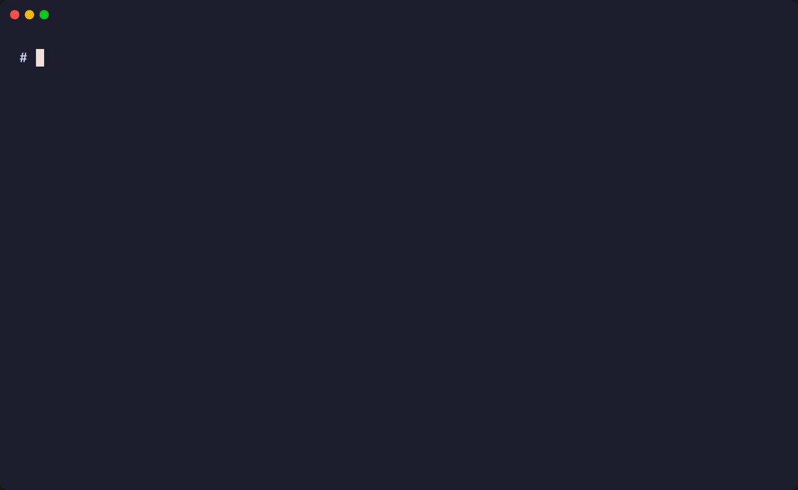

# microtask

**A task and notes manager for you and your AI agents, kept as plain Markdown
files in your own Git repo.**

<p align="center">
  
</p>

Most task apps store your data on their servers in their own format. microtask
keeps each task and note as a Markdown file in a private repository you own, so
you, your editor, and your agents all work on the same files. Everything starts
from the `mt` command, and `mt web` adds a lightweight local dashboard when you
want the overview.

## Why microtask

- **Plain files you own.** One Markdown file per card. Open it in any editor,
  grep it, and read it in ten years without microtask.
- **Nothing to install.** Runs with the Bash and Python 3 already on macOS and
  Linux, and there is no account to create.
- **Terminal first.** Capture in a second with `mt add`, find anything with
  `mt search`, and pipe text in from other tools. The dashboard is optional and
  edits the same files.
- **Ready for your agents.** Any agent that can run shell commands can use it
  without extra setup. The `AGENTS.md` and microtask skill in the app folder explain
  the commands, and the CLI rejects edits made from an outdated copy of a card,
  so an agent can work on your list safely.
- **Synced and versioned by Git.** `mt sync` backs up to your private repo and
  keeps your machines in step, with full history of every change.

## Quick start

Install with one command:

```bash
curl -fsSL https://raw.githubusercontent.com/pablormier/microtask/main/install.sh | bash
```

It downloads the latest release, asks where to put it and your cards (Enter
accepts each default), and adds `mt` to your shell config. Or clone the
repository and create its workspace, with nothing else to set up:

```bash
git clone https://github.com/pablormier/microtask.git && cd microtask && ./mt init
```

Then, in a new terminal (or `./mt` in the clone):

```sh
mt add "Call the dentist" --status active
mt list
mt move @4e91a7c2 doing      # use the @reference that mt list prints
mt done @4e91a7c2
```

Run `mt demo` to try microtask with bundled example cards in a temporary
workspace (deleted automatically when you stop it).

To sync across machines, create an empty private repository (not a fork,
which GitHub keeps public) and give its URL when the installer asks. On
another machine, run the installer again and give it the same URL: it clones
your cards into the new workspace.

## Where things live

The app and your cards are kept apart, so an update never touches your data.

```
microtask/                 the app: replaced as a whole by mt update
  mt  scripts/  tools/  templates/  .agents/skills/  ...
  workspace/               your data, created by the installer or ./mt init
    cards/  drafts/  settings.yaml    what mt sync shares
    settings.local.yaml  .mt/         this machine only, safe to delete
```

`workspace/` can be its own Git repository, which is how `mt sync` backs it up
to your private repo. To keep your cards somewhere else, such as a synced
folder, set `MT_WORKSPACE` to its absolute path in your shell config; the
installer does this when you choose another workspace folder.

## Updating

```sh
mt update --check     # show the current, next and latest version and what would change
mt update             # install the next release
```

`mt update` downloads a release and replaces the app files. It needs no Git,
and it leaves your workspace alone. Before 1.0 it moves one minor version at a
time, so after a jump it asks you to run it again. See
[Install, sync, and updates](docs/sync-and-updates.md#update). In a Git clone,
use `git pull`.

## Moving an old install

Earlier versions kept the app and your cards in one folder, which was also your
Git repository. Version 0.2.0 asks you to migrate it. Run `mt migrate` in
that folder (`mt migrate --check` shows what would happen first). It moves your
`.git`, `cards/`, `drafts/`, and settings into `workspace/`, renames
`mt-policy.yaml` to `settings.yaml`, and makes one commit there that records the
removal of the app files and the rename. Nothing is pushed.

Once that commit is pushed, for example by `mt sync`, other machines still on
the old layout will lose their app files on their next pull. On each of them,
run the installer or `mt migrate` before syncing. The commit also renames
`mt-policy.yaml` to `settings.yaml`, which older versions do not read, so every machine
must be on 0.2.0 or later before it syncs.

If another machine already pulled that commit, its app files are gone and the
old folder now holds only your cards and settings, which is a valid workspace
folder. Run the installer and enter that folder at the "Workspace folder"
prompt (or pass `--workspace FOLDER`) to get it working again.

## A card is just Markdown

```markdown
---
id: 2026-11-09-140000-fix-login-timeout-bug
title: Fix login timeout bug
kind: task
status: active
priority: high
type: bug
topic: work
due: '2026-11-10'
due_kind: deadline
tags:
- bug
- auth
next_action: Reproduce the timeout with a throttled browser session.
comments:
- at: '2026-11-10T09:10:00'
  text: Suspect the refresh token call is not retried.
---
Users on slow connections get logged out after 30 seconds.

## Plan

- [x] Reproduce with network throttling
- [ ] Start the idle timer on `load` instead of `navigationStart`
```

Properties live in the frontmatter; the body is free-form Markdown with tables,
checklists, code, and math. See [Card files](docs/cards.md).

## Dashboard

When you want to see everything at once, `mt web` opens a board in your
browser. It is served by `mt` itself from your machine, needs nothing extra
installed, and stops when you press Ctrl+C.


## Working with AI agents

Start your agent inside the workspace from any directory with `mt run`:

```sh
mt run claude      # or: mt run codex, mt run agy
```

Then ask in plain language:

- *"Add a task to renew my passport before March, high priority."*
- *"Triage my inbox."*
- *"What should I work on next? Start it and keep notes in the card."*

<p align="center">
  
</p>

Skills in [`.agents/skills`](.agents/skills) cover the common workflows:

- **[mt-triage](.agents/skills/mt-triage/SKILL.md)** turns raw captures into
  clear tasks and notes. It proposes a title, status, priority, and dates for
  each card in a table, and applies them once you approve.
- **[mt-focus](.agents/skills/mt-focus/SKILL.md)** picks what to work on next
  for the time and energy you have, and gives a small first step.
- **[mt-paper-review](.agents/skills/mt-paper-review/SKILL.md)** reads a paper
  with you, journal-club style, and saves the review as a note.
- **[mt-weekly](.agents/skills/mt-weekly/SKILL.md)** summarizes the week's
  work in a few points you can paste into a status update.

The agent follows [AGENTS.md](AGENTS.md) and the
[microtask skill](.agents/skills/microtask/SKILL.md). Codex and Cursor read
`AGENTS.md` on their own, and the `CLAUDE.md` and `GEMINI.md` next to it
point Claude Code and Gemini CLI to it. For other agents, ask them to read
`AGENTS.md` first. The agent proposes new cards for your review before
creating them, claims a task before working on it, and does not complete or
delete anything without your OK.

To let agents in another project track their work here, run
`mt skills install --project NAME` in that project. See
[Workspaces](docs/guide.md#workspaces) for keeping a
project's cards in a workspace of their own.

With Git (the installer's default), `git diff` shows exactly what an agent
changed in your workspace, and you can undo any of it.

## Learn more

- [Guide](docs/guide.md): statuses, capture, search, topics, the dashboard,
  drafts, and workspaces
- [Card files](docs/cards.md): the file format and safe scripted edits
- [Install, sync, and updates](docs/sync-and-updates.md): remotes, new
  machines, and keeping the app up to date
- [Using microtask from your phone](docs/mobile.md): Codex Cloud / Claude mobile
  apps, ChatGPT GitHub issue capture (`mt import-github`), `mt web` over
  Tailscale, and an optional Telegram bot on a Pi/VPS
- [Hosting for a few people](docs/hosting.md): one dashboard per user on a
  Linux server, behind a sign-in proxy
- `mt help` and `mt COMMAND --help`: every command and option

Contributing: read [CONTRIBUTING.md](CONTRIBUTING.md) and the [test guide](tests/README.md).

## License

microtask is released under the [MIT License](LICENSE). It bundles PyYAML under
its own MIT license ([scripts/vendor/PyYAML-LICENSE](scripts/vendor/PyYAML-LICENSE)).
