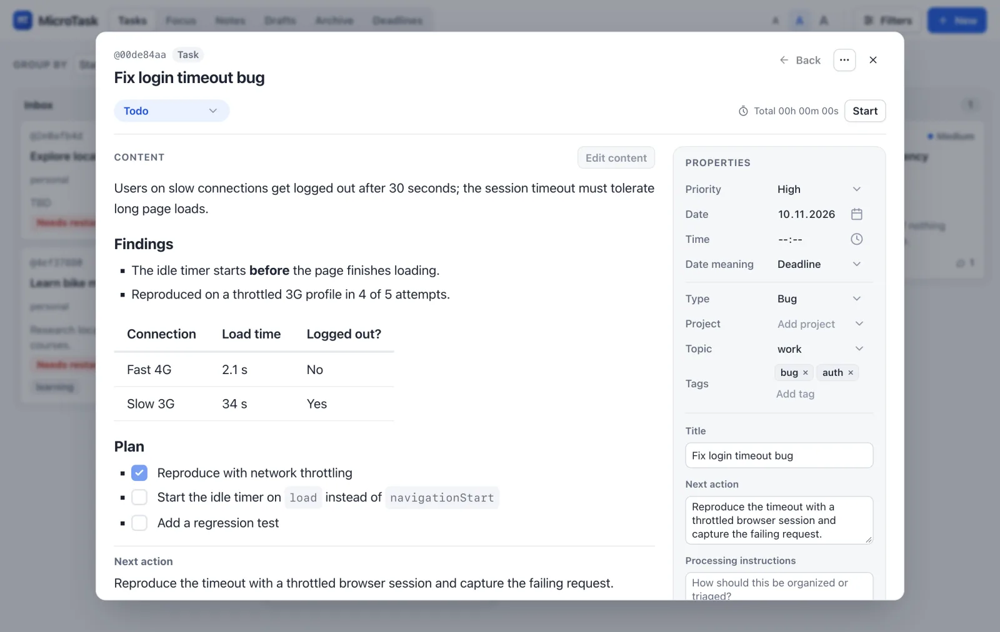

# microtask guide

How to work with microtask day to day. For every option of a command, run
`mt COMMAND --help`; this guide explains the ideas and the common workflows.

- [Cards: tasks and notes](#cards-tasks-and-notes)
- [Statuses](#statuses)
- [Capture](#capture)
- [Find](#find)
- [Work on tasks](#work-on-tasks)
- [Topics, projects, and tags](#topics-projects-and-tags)
- [The dashboard](#the-dashboard)
- [Drafts](#drafts)
- [Workspaces and views](#workspaces-and-views)
- [Settings](#settings)

## Cards: tasks and notes

Everything you capture is a **card**: one Markdown file in `cards/`. A card is
either a task (something to do) or a note (something to keep). Both share the
same format, described in [Card files](cards.md), and you can switch a card's
kind at any time with `mt convert REF task|note`.

Commands refer to cards by the short `@reference` that `mt list` prints, such
as `@4e91a7c2`. You can also use a unique part of the title.

## Statuses

| Status    | Shown as    | Use it for                                          |
|-----------|-------------|-----------------------------------------------------|
| `inbox`   | Inbox       | Captures that still need a decision or clarification |
| `active`  | Todo        | Clear tasks ready to do                              |
| `doing`   | In progress | What you are working on now                          |
| `waiting` | Waiting     | Blocked on someone else                              |
| `done`    | Done        | Finished                                             |

Plain `mt add` uses the workspace default (normally inbox). Add a clear task
straight to Todo with `--status active`.

## Capture

```sh
mt add "Call the dentist" --status active
mt add "Review the application" --next-action "Start with section 3"
mt note "Meeting notes" --file meeting.md --project research --tag reading
pbpaste | mt add --title "Triage this email" --status active
mt capture "Call the dentist"     # interactive review in the terminal
```

- `mt note` is `mt add --kind note`.
- **Next action** is optional: a smaller first step, or where to resume.
- **Processing instructions** (`--instructions`) are optional guidance for
  whoever triages the card later, you or an agent.
- With no text or `--file`, piped input becomes the body; on a terminal,
  `mt note` opens your editor.
- `mt capture` walks you through title, status, priority, and date with the
  arrow keys. Enter accepts the shown default, Ctrl+D finishes text, Esc cancels.

## Find

```sh
mt list                                        # every open task and note
mt list --kind task --status active --sort due --limit 10
mt list --needs-review
mt search dentist appointment --match all
mt read @4e91a7c2
```

`list` and `search` share filters (status, kind, type, project, topic, tags,
dates), sorting, limits, and `--json`; `--full` prints whole cards
as `mt read --json` does. Archived and hidden cards are left out
unless you pass `--all`, `--archived`, or `--hidden`. Date filters take
`YYYY-MM-DD`; `since` includes the date and `before` excludes it.

## Work on tasks

```sh
mt move @4e91a7c2 doing                       # start; claims the task for you
mt edit @4e91a7c2 --set priority=high --tags '["health"]'
mt comment @4e91a7c2 "Called, waiting for a slot"
mt done @4e91a7c2 --note "Appointment booked"
```

- Moving a task to `doing` claims it under your name, so people and agents
  sharing the workspace don't pick up the same task. Finishing releases it.
- `mt focus` suggests one task to work on next; `mt followup` lists waiting
  tasks that need a nudge.
- `mt time start REF` claims a task in `doing` and saves and switches your
  previous timer. Use `--parallel` to keep your other timers running. Timers
  belong to the username selected by `--by`, `MT_USERNAME`, or workspace defaults.
  `mt time stop [REF]` saves time; `mt time report` summarizes saved sessions.
  Moving out of `doing`, completing, archiving, hiding, or taking over a task
  saves its running session in the same card transaction. Converting or deleting
  a task with a running timer is refused.
- Correct a forgotten timer with `mt time stop REF --at 2026-11-10T17:30`
  or `--duration 2h`. Add past work with `mt time add REF --start
  2026-11-10T09:00 --end 2026-11-10T11:00`, or `mt time add REF 2h --end
  2026-11-10T11:00`. The end defaults to now. Times are local, without offsets;
  a bare `HH:MM[:SS]` means today. `elapsed_seconds` is authoritative, including
  across daylight saving changes; reports sum it rather than subtracting timestamps.
- `mt time status` lists owners and orphan timers. Clear an orphan with
  `mt time cancel TASK_ID`; cancel discards the session. Malformed local timer
  state is preserved in `.mt/recovery/` with a warning so card operations can
  continue. `rules.timer_warn_hours` (default 8) flags long timers in status and
  the board, without capping time. Running timers stay local to this checkout.

## Topics, projects, and tags

- **Topic**: where a card lives, as a path like `learning/rust/async`. Topics
  never end. Parents exist automatically, so `mt list --topic learning`
  includes everything below it. `mt topic list` shows the top level, with a
  `/` after topics that have subtopics, and `mt topic list learning` looks
  inside one. Add `--tree` to see every level, `--paths` for full paths you
  can pass to `--topic`, or `--json` for the full tree as data.
  `mt topic rename OLD NEW` moves a whole subtree.
- **Project**: a finite effort that will be finished.
- **Tags**: free keywords.

## The dashboard

`mt web` opens a local dashboard in your browser until you press Ctrl+C. It
shows a board you can group by status, priority, project, topic, tag, and more, plus Focus, Notes, Drafts,
Archive, and Deadlines views. You can edit card content and properties, comment,
and track time there. It edits the same files as the CLI, and nothing leaves
your machine. `mt show REF` opens a read-only preview of a single card.

Board filters are kept in the page address, so a reload keeps them and a
bookmark returns to the same board. They apply to every tab except Drafts, and
a card created while the board is filtered to a project or topic starts there.
To keep one workspace for many efforts and open the board for just one of them:

```sh
mt web --project release              # or --topic work/infra, --tag review
mt web --project release --port 8765  # a fixed port keeps bookmarks working
```

To stay in one project from the command line, set `MT_PROJECT` (or
`MT_TOPIC`) for the shell. `add`, `note`, `list`, `search`, `focus`, `view`,
`bulk-edit`, and `web` then behave as if you had passed `--project`, and print a
`Scope:` line so you can tell. An explicit `--project` or `--topic` wins.

```sh
export MT_PROJECT=release
mt add "Write release notes"          # filed under project release
mt list                               # only release cards
unset MT_PROJECT
```



## Drafts

Drafts are unfinished cards or edits kept in `drafts/`. They stay out of lists,
search, and focus until you apply them. The dashboard saves drafts as you type,
and the CLI works on the same files:

```sh
mt draft list
mt draft create note --title "Meeting follow-up" --file notes.md
mt draft recover          # recover editor copies left behind by a crash
```

Applying a draft checks that neither the draft nor its target card changed in
the meantime, so a stale draft never overwrites newer work.

## Workspaces and views

A **workspace** is one folder (normally one Git repository) holding the app,
your `cards/`, and settings. An installed `mt` always uses the workspace it
lives in, regardless of your current directory. To work with another one:

```sh
mt repo add work "$HOME/work-tasks"   # short alias, stored on this machine
mt -R work list                       # -R goes before the command
```

For agents working in another project to track their work in your workspace,
add a section to that project's `AGENTS.md`. `--project` files their cards
under that project and limits what they see to it:

```sh
mt agent-setup --project myapp >> ~/code/myapp/AGENTS.md
```

The section tells agents to run `mt` and to read the rules and skills with
`mt run cat`, so it contains no paths from your machine and is safe to commit.
It needs `mt` installed on each machine where the agents run.

To give a project its own workspace, for example one where agents developing
a package plan their work and someone else supervises it, create a second
workspace outside the project. Plain `mt` keeps running your personal one:

```sh
mt init ~/work/pkg-tasks                                  # downloads microtask
mt init ~/work/pkg-tasks git@github.com:YOU/pkg-tasks.git # and shares it with mt sync
mt init ~/work/pkg-tasks --local                          # offline copy of your mt
mt repo add pkg ~/work/pkg-tasks
mt -R pkg agent-setup >> ~/code/my-package/AGENTS.md
```

The default downloads the latest microtask, ready for `mt update`. `--local`
works without internet: it copies the app and your settings from the `mt` you
run, never your cards, drafts, or local state, and has no Git until you add it.
For a workspace that is not the `mt` on PATH, the section uses `mt -R pkg`, so
run `mt repo add pkg PATH` on each machine where the agents run.

A **view** is a disposable, editable copy of part of a workspace, for focused
work or experiments. Edits stay in the copy and are never written back, so to
see or work on one project's live cards, filter instead (`mt list --project`,
`mt web --project`):

```sh
mt view --project release             # creates .mt/views/release
.mt/views/release/mt list
```

## Settings

Workspace settings live in `mt-policy.yaml` and are synced with your cards.
Machine-specific overrides go in `mt-policy.local.yaml`, which is not synced.
`mt policy` shows the effective values, including the defaults for new cards,
the work-in-progress limit, and `rules.auto_sync`.
