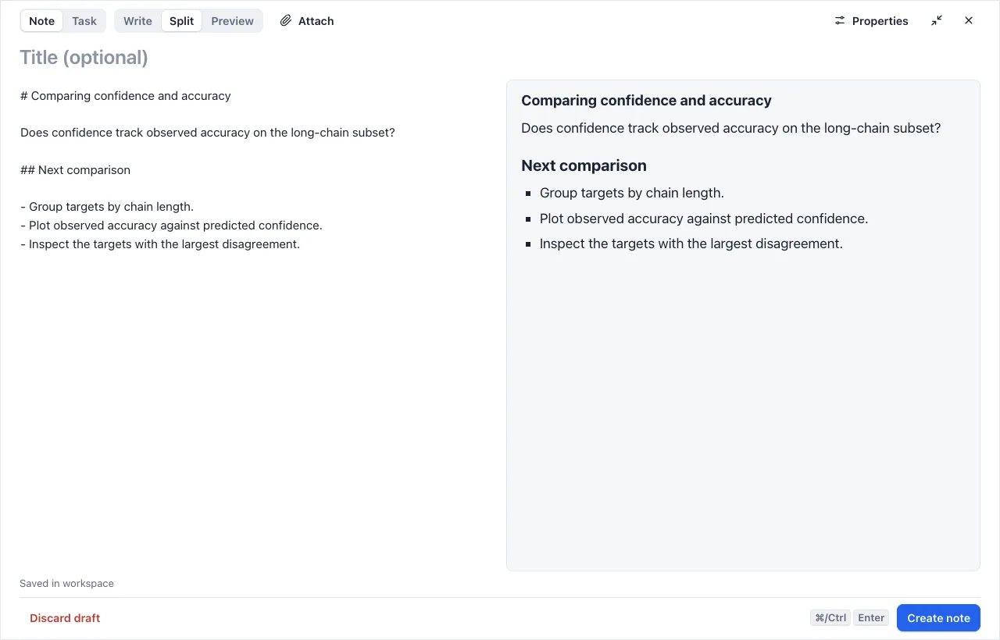

# microtask guide

How to work with microtask day to day. For every option of a command, run
`mt COMMAND --help`; this guide explains the ideas and the common workflows.

- [Cards: tasks and notes](#cards-tasks-and-notes)
- [Statuses](#statuses)
- [Capture](#capture)
- [Find](#find)
- [Work on tasks](#work-on-tasks)
- [Topics, projects, and tags](#topics-projects-and-tags)
- [The dashboard](#the-dashboard)
- [Drafts](#drafts)
- [Workspaces](#workspaces)
- [Settings](#settings)

## Cards: tasks and notes

Everything you capture is a **card**: one Markdown file in the workspace's `cards/` folder. A card is
either a task (something to do) or a note (something to keep). Both share the
same format, described in [Card files](cards.md), and you can switch a card's
kind at any time with `mt convert REF task|note`.

Commands refer to cards by the short `@reference` that `mt list` prints, such
as `@4e91a7c2`. You can also use a unique part of the title.

## Statuses

| Status    | Shown as    | Use it for                                          |
|-----------|-------------|-----------------------------------------------------|
| `inbox`   | Inbox       | Captures that still need a decision or clarification |
| `active`  | Todo        | Clear tasks ready to do                              |
| `doing`   | In progress | What you are working on now                          |
| `waiting` | Waiting     | Blocked on someone else                              |
| `done`    | Done        | Finished                                             |

Plain `mt add` uses the workspace default (normally inbox). Add a clear task
straight to Todo with `--status active`.

## Capture

```sh
mt add "Call the dentist" --status active
mt add "Review the application" --next-action "Start with section 3"
mt note "Meeting notes" --file meeting.md --project research --tag reading
pbpaste | mt add --title "Triage this email" --status active
mt capture "Call the dentist"     # interactive review in the terminal
```

- `mt note` is `mt add --kind note`.
- **Next action** is optional: a smaller first step, or where to resume.
- **Processing instructions** (`--instructions`) are optional guidance for
  whoever triages the card later, you or an agent.
- With no text or `--file`, piped input becomes the body; on a terminal,
  `mt note` opens your editor.
- `mt capture` walks you through title, status, priority, and date with the
  arrow keys. Enter accepts the shown default, Ctrl+D finishes text, Esc cancels.

## Find

```sh
mt list                                        # every open task and note
mt list --kind task --status active --sort due --limit 10
mt list --needs-review
mt search dentist appointment --and
mt read @4e91a7c2
```

One set of filters selects cards everywhere: `list`, `search`, `focus`,
`bulk-edit`, `time list`, `time report`, `mt web`, and the
dashboard's filter bar. Filters on different fields combine; repeat a filter to
accept several values (`--status active --status doing`). The fields are
`--kind`, `--status`, `--priority`, `--task-type`, `--project`, `--topic`, `--tag`,
`--needs-review`, `--triage`, the date ranges `--created-*`, `--updated-*`,
`--completed-*`, and `--due-*` (with `since` and `before`), `--due MODE`
(`overdue`, `today`, `week`, `next` for overdue plus week, `any`, `none`), `--archived`, and `--hidden`. `search`
also takes words, with `--and`, `--or`, or `--fuzzy`. Sorting,
limits, and `--json` belong to `list` and `search`; `--full` prints whole cards
as `mt read --json` does.

Archived and hidden cards are left out. `--archived` and `--hidden` take
`exclude` (the default), `include`, or `only` (bare means `only`), and `--all`
includes both. `list` also leaves out done tasks completed longer ago than
`rules.done_window` (default `2w`); see them with `--status done`,
`--completed-since`, `--archived include`, or `--all`, or in the dashboard's
Archive tab. `mt time list` and `mt time report` include archived and hidden
tasks, since history should not disappear; `--session-since` and
`--session-before` count only sessions that started inside a period, for
example `mt time report --session-since 1w`. Date filters take
`YYYY-MM-DD` or an age such as `2w`, `3m`, or `1y` (days, weeks, months, years
back from today); `since` includes the date and `before` excludes it. A card
without that date never matches a date filter.

```sh
mt list --updated-before 6m                    # cards untouched for six months
mt bulk-edit --updated-before 1y --set archived=true --json > plan.json
mt bulk-edit --apply plan.json                 # archive them after reviewing the plan
```

`bulk-edit` only previews until you apply the saved plan, and the plan stores
its query with resolved dates, so applying it later affects the same cards. A
plan saved by an older version asks you to run the preview again.

## Work on tasks

```sh
mt move @4e91a7c2 doing                       # start; claims the task for you
mt edit @4e91a7c2 --set priority=high --tags '["health"]'
mt comment @4e91a7c2 "Called, waiting for a slot"
mt done @4e91a7c2 --note "Appointment booked"
```

- Moving a task to `doing` claims it under your name, so people and agents
  sharing the workspace don't pick up the same task. Finishing releases it.
- `mt focus` suggests one task to work on next; `mt list --status waiting`
  lists waiting tasks that need a nudge.
- `mt time start REF` claims a task in `doing` and saves and switches your
  previous timer. Use `--parallel` to keep your other timers running. Timers
  belong to the username selected by `--by`, `MT_USERNAME`, or workspace defaults.
  `mt time stop [REF]` saves time; `mt time report` summarizes saved sessions.
  Moving out of `doing`, completing, archiving, hiding, or taking over a task
  saves its running session in the same card transaction. Converting or deleting
  a task with a running timer is refused.
- Correct a forgotten timer with `mt time stop REF --at 2026-11-10T17:30`
  or `--duration 2h`. Add past work with `mt time add REF --start
  2026-11-10T09:00 --end 2026-11-10T11:00`, or `mt time add REF 2h --end
  2026-11-10T11:00`. The end defaults to now. Times are local, without offsets;
  a bare `HH:MM[:SS]` means today. `elapsed_seconds` is authoritative, including
  across daylight saving changes; reports sum it rather than subtracting timestamps.
- `mt time status` lists every running timer with its owner, card and start.
  Several at once is normal: `--parallel` allows it and a sync can bring one
  in. Settle one with `mt time stop REF`, or discard it with `mt time cancel
  REF`. A running timer is the `timer` property of its card (see
  [card files](cards.md)), so it syncs like any other edit.
  `rules.timer_warn_hours` (default 8) flags long timers in status and the
  board, without capping time.

## Topics, projects, and tags

- **Topic**: where a card lives, as a path like `learning/rust/async`. Topics
  never end. Parents exist automatically, so `mt list --topic learning`
  includes everything below it. `mt topic list` shows the top level, with a
  `/` after topics that have subtopics, and `mt topic list learning` looks
  inside one. Add `--tree` to see every level, `--paths` for full paths you
  can pass to `--topic`, or `--json` for the full tree as data.
  `mt topic rename OLD NEW` moves a whole subtree.
- **Project**: a finite effort that will be finished.
- **Tags**: free keywords.

## The dashboard

`mt web` opens a local dashboard in your browser until you press Ctrl+C. It
shows a board you can group by status, priority, project, topic, tag, and more, plus Focus, Notes, Drafts,
Archive, and Deadlines views. You can edit card content and properties, comment,
and track time there. It edits the same files as the CLI and runs on your
machine. `mt show REF` opens a read-only preview of a single card, as one
self-contained HTML file that works offline. If you run `mt update` while a
dashboard is open, the running server keeps using the code
it started with and shows a notice on the board; restart `mt web` to pick up the
updated version.

Run `mt demo` to open a temporary demo workspace seeded with a protein
structure ML research board. Open **Audit the benchmark split** to try its
checklist and follow a reference to the split protocol. In **Notes**, look for
the AlphaFold paper summary and the causal inference course tracker.
**Deadlines** shows a mix of hard deadlines, a reminder, and a target, with dates
shifted relative to today. All demo changes are local and deleted automatically
when you stop `mt demo`.

Filters opens a row of filter chips under the title: Status, Priority, Type, Project,
Topic, Tags, Due, and Updated, beside a search box. Each chip opens a list where
you tick one or more values; a card matches when it has any value ticked in a
chip, and it must match every chip you use. An active chip shows its values and
has an x to clear it. The Filters button shows how many filters are active,
and Clear filters resets them all. Include hidden and Needs
review only are in the `...` menu. Status does not filter Notes or the Archive.
The Updated filter shows cards changed in the last 2 weeks, month, 3 months, or
year, or cards not changed in 3 months or a year; it takes one choice.

Board filters are kept in the page address, so a reload keeps them and a
bookmark returns to the same board. They apply to every tab except Drafts, and
a card created while the board is filtered to exactly one project or topic
starts there. To keep one workspace for many efforts and open the board for just
one of them (repeat a flag to show several):

```sh
mt web --project release              # or --topic work/infra, --tag review, --updated-before 1y
mt web --project release --project docs --port 8765  # a fixed port keeps bookmarks working
```

To stay in one project from the command line, set `MT_PROJECT` (or
`MT_TOPIC`) for the shell. `add`, `note`, `list`, `search`, `focus`,
`bulk-edit`, and `web` then behave as if you had passed `--project`, and print a
`Scope:` line so you can tell. An explicit `--project` or `--topic` wins.

```sh
export MT_PROJECT=release
mt add "Write release notes"          # filed under project release
mt list                               # only release cards
unset MT_PROJECT
```

## Drafts

Drafts are unfinished new cards kept in `drafts/`. They stay out of lists,
search, and focus until you create them. The capture composer saves drafts as
you type (and can expand into a full-screen **Zen mode** with `Write`, `Split`,
and `Preview` views via `⤢` or `Cmd/Ctrl+Shift+F`).



The CLI works on the same drafts:

```sh
mt draft list
mt draft create note --title "Meeting follow-up" --file notes.md
```

Saving a draft checks its revision so another tab or the CLI never silently
overwrites newer changes.

## Attachments

Images and other files you add to a card live in `attachments/`, next to
`cards/` in the workspace. In the dashboard, paste an image, drop a file, or
use the Attach button in the card editor, the capture composer, or the comment
box. The file is copied into `attachments/` and a Markdown link is inserted at
the cursor. From the CLI, `mt attach FILE` copies a file and prints the link;
add `--card REF` to append the link to a card:

```sh
mt attach chart.png --card "Quarterly review"
```

Cards refer to attachments as `../attachments/NAME`, which also works in any
Markdown viewer that opens the card file. Files larger than
`rules.max_attachment_mb` (10 by default) are refused. `mt sync` commits
attachments with the cards. `mt validate` reports broken attachment links
(`lint.broken_attachment` in `settings.yaml` can turn that warning off).

## Workspaces

A **workspace** is the folder that holds your `cards/`, `drafts/`,
`attachments/` and settings, usually as its own Git repository. Plain `mt`
uses `workspace/` in the app folder, created by the installer or `./mt init`,
from whatever folder you run it in.

To keep a project's cards apart from yours, or to share them with other people,
create a second workspace folder and give it a short name on this machine:

```sh
mt init ~/work/pkg-tasks --data                                   # with Git, no remote
mt init ~/work/pkg-tasks git@github.com:YOU/pkg-tasks.git --data  # shared with mt sync
mt repo add pkg ~/work/pkg-tasks
mt -R pkg add "First task"                                        # -R goes before the command
```

Your one `mt` runs every workspace folder, so `mt update` keeps them all
current. Each machine that uses a folder needs `mt` and its own `mt repo add`.
For cards that only need grouping, filing them in your own workspace with
`--project NAME` is simpler.

`mt init DIRECTORY` without `--data` installs a separate copy of microtask with
its own workspace, for a project that needs to stay on its own version.
`--local` makes that copy from your installed `mt` without downloading
anything. See `mt init --help`.

### A default workspace folder

If you use one workspace folder most of the time, set `MT_WORKSPACE` in your
shell config instead of typing `-R` on every command. The installer does this
when you choose a workspace outside the app folder:

```sh
export MT_WORKSPACE="$HOME/Dropbox/todos"   # absolute path to a workspace folder
mt list                                     # now lists that workspace
```

The path must be absolute and must point at a workspace folder that exists;
anything else is refused with an error, and nothing is created. `-R` still
wins, so `mt -R work list` works as before. Remove the line to go back to
`workspace/` in the app folder.

Inside a workspace or one of its subfolders, bare `mt` uses that workspace
when `MT_WORKSPACE` is unset. If `MT_WORKSPACE` names a different workspace,
`mt` stops and shows both paths. Use `-R PATH_OR_NAME` to select the workspace
explicitly. Outside a workspace, `MT_WORKSPACE` sets the default.

### Agent skills in a workspace

New workspaces get the bundled skills in `.agents/skills/` and
`.claude/skills/`, plus an `AGENTS.md` and `CLAUDE.md` for agents started
there. The skills run plain `mt`, which selects the workspace they are in, so
they keep working after you move the workspace or sync it to another machine.
They are ignored by Git. To add them to an existing workspace, along with any
missing `AGENTS.md` or `CLAUDE.md`, run `mt skills install --workspace` in it,
or `mt -R NAME skills install --workspace` from anywhere. `mt update` refreshes
them; in a Git clone of the app, run the install again after `git pull`.

### Agents in another project

For agents working in a project to track their work, install microtask's
skills there. Run it from the project folder, selecting the workspace the same
way as any other command:

```sh
cd ~/code/myapp
mt skills install --project myapp     # your workspace, limited to the project
mt -R pkg skills install              # another workspace
```

This copies every skill into `.agents/skills/` and `.claude/skills/`, with each
command already pointing at the workspace: `MT_PROJECT=myapp mt` or
`mt -R pkg`. A workspace with an alias gives skills free of paths from your
machine, safe to commit; each machine where the agents run then needs `mt` and
the same `mt repo add`. Without an alias the skills use the workspace's path,
so keep them out of Git. Run `install` again after `mt update` to refresh them,
and `mt skills uninstall` to remove them. Skills of your own in those folders
are never changed.

## Settings

Workspace settings live in `settings.yaml` and are synced with your cards.
Overrides for one machine go in `settings.local.yaml`, which is not synced.
`mt settings` shows the effective values, such as the defaults for new cards,
`rules.auto_sync`, and `rules.max_attachment_mb`.

For optional calendar context in focus and weekly planning, see
[Calendar setup](calendar.md). Your agent app supplies calendar access;
microtask stores which calendars to use and how to interpret their events.
