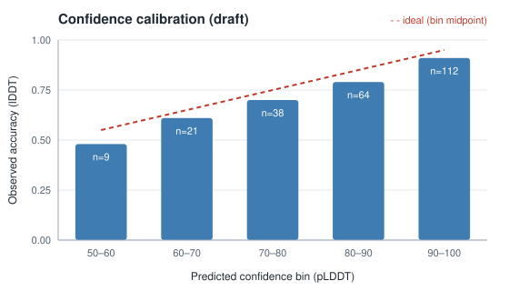

Start with the confidence discussion in the AlphaFold paper notes @c07d99b2. Report bin counts and stratify by target length. Flag any bin too small to interpret at lab meeting @f19f2a4e.

First pass on the validation split. Confidence runs slightly ahead of observed accuracy in every bin, and the 50–60 bin is too small to read on its own:

